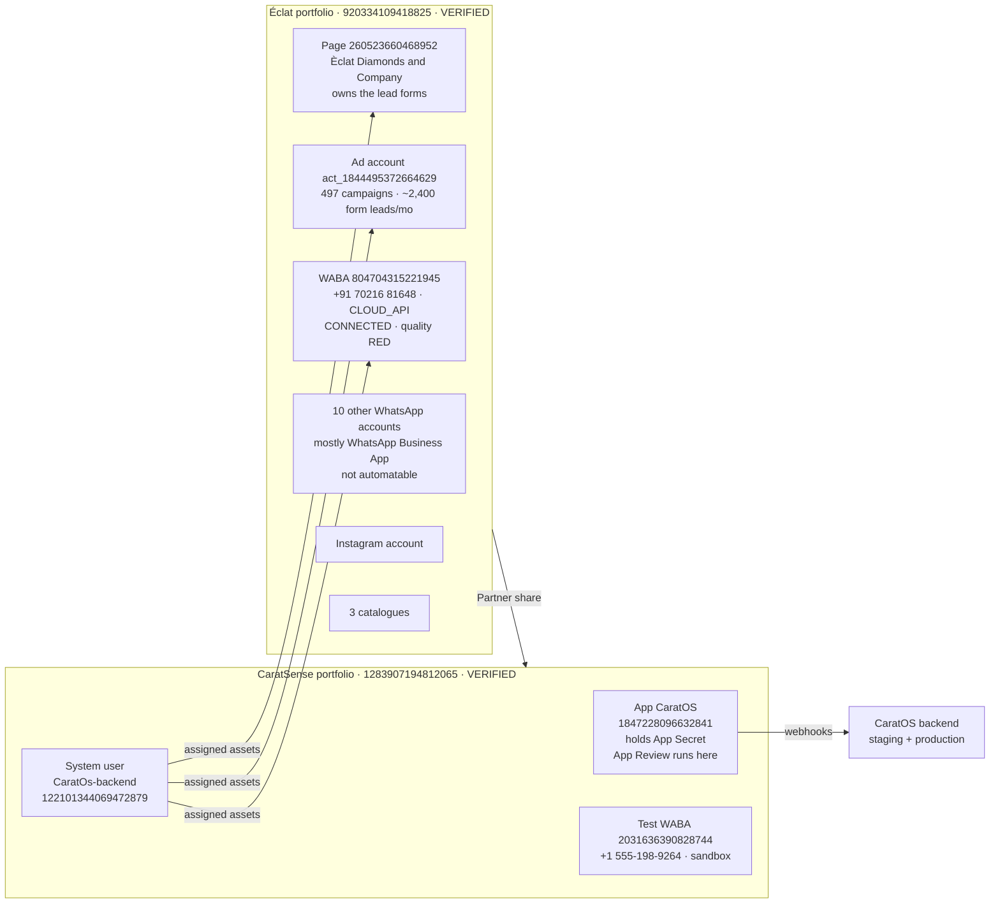
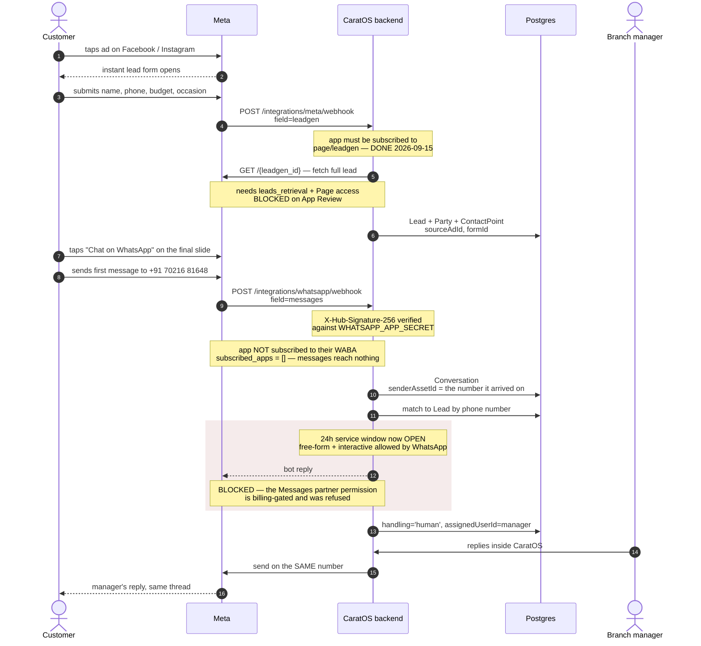
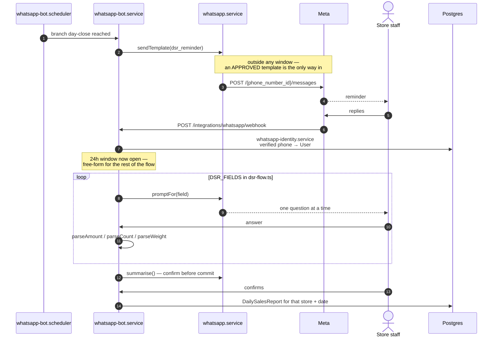
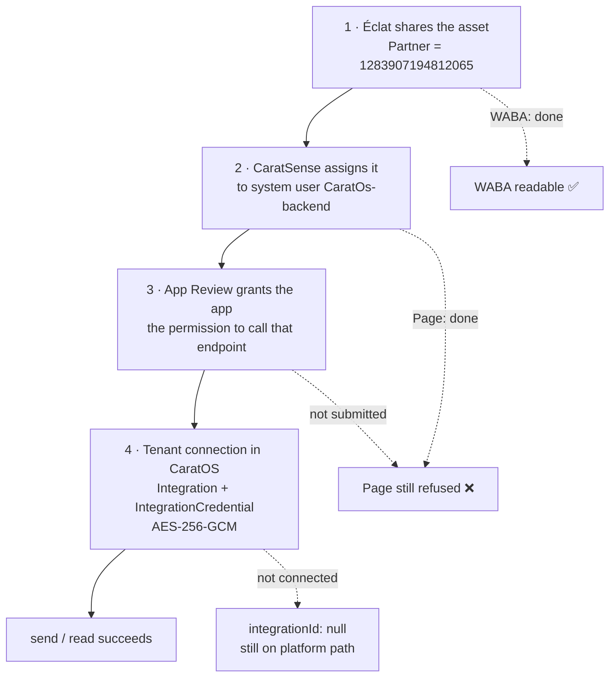
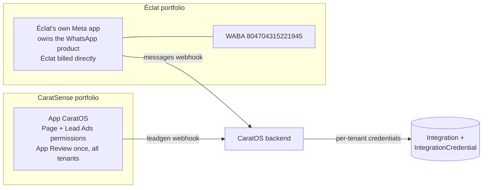
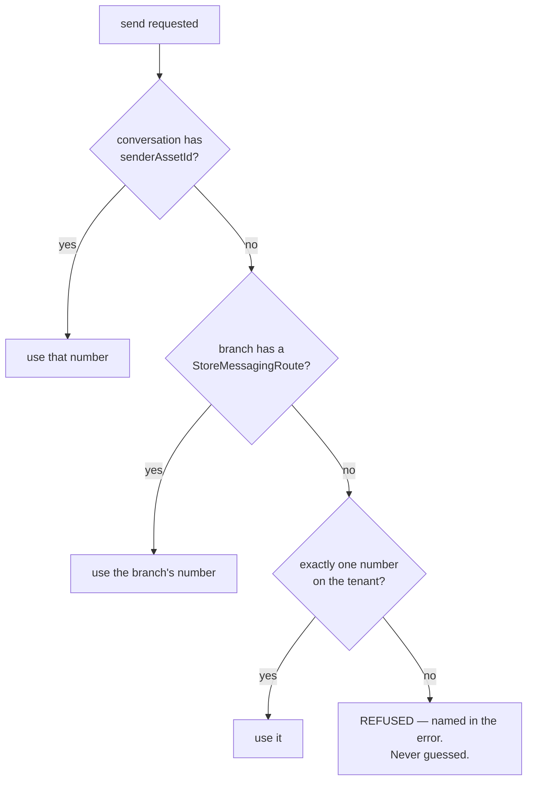

# Meta integration — architecture

> Éclat Diamonds on CaratOS. Two WhatsApp bots, one Meta app, two Business
> portfolios. Everything below was verified against the live Graph API and the
> code on `phase-6-meta-integrations` unless marked otherwise.
>
> Written for the dev side. Companion docs:
> [META-SETUP-RUNBOOK.md](META-SETUP-RUNBOOK.md) is the click-by-click account
> setup; [META-INTEGRATION-AND-CLIENT-MEETING.md](META-INTEGRATION-AND-CLIENT-MEETING.md)
> carries the client history and evidence.
>
> **Credential model changed 2026-09-18.** Partner sharing carries *reading* but
> not *sending* — see §5.1. Each client now owns their own Meta app. Recorded in
> `DECISIONS.md` (2026-09-18).
>
> Last verified **2026-09-18**.

---

## 1. Account topology

The app is ours; the assets are theirs. Nothing moves between portfolios — Éclat
grants access via Partner sharing and can revoke it.



**Why not a system user inside Éclat's portfolio:** the token would belong to
their business. If anyone there deletes it, the integration dies and we have no
visibility into why. Partner sharing keeps the credential on our side.

---

## 2. The two bots

They share a code path for inbound but differ in almost every other respect.

| | **Customer bot** | **DSR bot** |
|---|---|---|
| Number | `+91 70216 81648` (WABA `804704315221945`) | `+91 72080 17690` (new SIM, WABA not yet created) |
| Portfolio | Éclat's | Éclat's or CaratSense's — **open decision** |
| Who starts | the customer, always | **we do**, at branch day-close |
| 24h window | open — free-form, buttons, lists | closed — **template required every time** |
| Audience | strangers from ads | ~20 known, phone-linked staff |
| Volume | ~2,400/mo inbound | ~7/day outbound |
| Quality risk | high (blocks/reports) | negligible |
| Code | **not built** — see §7 | `whatsapp-bot/` — **built and shipping** |

**The split exists for risk isolation.** On one number, a customer-side quality
collapse would also take down day-close reporting.

---

## 3. Customer bot — end to end



### The referral question — unresolved

Meta attaches a `referral` object carrying `source_id` (the **ad id**) to inbound
messages from **click-to-WhatsApp ads**. `integrations/meta-referral.ts` already
parses it and `attribution.service.ts` matches on `ad_id`.

**Whether the same referral is attached when the customer arrives via a lead
form's "Chat on WhatsApp" button is not verified.** The ad→store routing design
depends on it.

Fallback if it isn't: the `leadgen` webhook already carries phone, form id and ad
id at submission time, so the branch is known *before* the customer messages, and
the conversation matches on phone number. Shreyansh's demo-ad test settles it.

---

## 4. DSR bot — end to end

Already built: `backend/src/whatsapp-bot/`.



`dsr-flow.ts` is the pattern the customer bot should follow: a field list, one
prompt at a time, typed parsers, a summary before commit, and `MAX_BACKDATE_DAYS`
guarding which day a report lands on.

**The template is the blocker.** `eclat_dsr_reminder` lived on the WABA that was
banned in September; templates are per-WABA and do not transfer. It must be
recreated and re-approved wherever the DSR bot lands.

---

## 5. Credential and permission chain

Four independent layers. A failure at any one looks identical from the outside —
`(#200)` or `(#100)` — which is why they are worth separating.



**Evidence that layers 1 and 2 are not the Page blocker:** the Page is shared and
assigned, and still returns

```
(#100) This endpoint requires the 'pages_read_engagement' permission
```

WhatsApp permissions come from the asset share; Page permissions come from App
Review. Hence `leads_retrieval`, `pages_read_engagement`, `pages_manage_ads`,
`pages_show_list`, `ads_read` and `business_management` in one submission.

### 5.1 Why partner sharing cannot carry sending — and what replaces it

Éclat shared WABA `804704315221945` to CaratSense as a Partner on 2026-09-16.
**Reading works. Sending does not**, and the block is structural rather than a
misconfiguration.

Meta greys out two permissions in the share dialog:

```
Messages                                 "send and respond to messages as the
                                          WhatsApp account"
Manage phone numbers and message
templates
        ⚠ "This permission can only be assigned to the partner
           who's responsible for billing."
```

The same two are greyed again one layer down, assigning the shared asset to the
`CaratOs-backend` system user — a business cannot grant a system user more than
the business itself holds. Two independent confirmations.

**Both workarounds are closed:**

| Attempt | Result |
|---|---|
| Éclat adds the CaratOS app to their portfolio | *"You don't own this app, so you can't add it"* — and the dialog warns the receiving portfolio would **become the owner** |
| CaratSense shares the app out to Éclat | **Assign partner disabled.** *"Businesses new to Facebook Products can share this asset… after several weeks of following our policies."* CaratSense's portfolio was created 2026-09-11 |
| CaratSense takes billing | Works, but billing attaches **per-WABA**, so Meta would charge CaratSense for *every* conversation on that number including Éclat's own marketing. Rejected — the client pays for the client's customers |

**Adopted model: one Meta app per client.**



Éclat owns the app and the WABA, so **the WhatsApp half needs no App Review** —
Meta grants messaging on your own assets without review. *Verify before relying
on it.* CaratSense's app still carries the Page and Lead Ads permissions, which
are app-scoped and reviewed once for every tenant.

**This is what blocks it, and it is code:**

```
meta-webhook.service.ts:42     META_APP_SECRET       ← one per deployment
whatsapp.service.ts:54         WHATSAPP_APP_SECRET   ← one per deployment
whatsapp.service.ts:333-344    HMAC verified against that single secret
```

One app per client means one secret per client. The secret must resolve
per-tenant, alongside the token `whatsapp-credentials.service.ts` already
resolves per-tenant.

> **Design note.** Signature verification runs *before* the tenant is known, and
> an unverified body must not be parsed to discover it. Cleanest resolution is a
> per-tenant callback path — `/integrations/whatsapp/webhook/:integrationId` —
> so the URL identifies the tenant, its secret is looked up, and the signature is
> verified before the body is touched.

**If the change is not made:** wait several weeks for Meta's lock to lift, then
have Éclat mint a token against the CaratOS app. No code, Éclat still pays,
nothing can be sent until then — and every future client repeats the wait.

### Per-tenant credentials, not env vars

`whatsapp-credentials.service.ts` resolves in order:

1. the tenant's own `Integration` + encrypted `IntegrationCredential`
2. platform env credentials — **only** for the org named in `WHATSAPP_PLATFORM_ORGANISATION_ID`
3. nothing → every send is a logged no-op carrying the reason

Per `docs/handovers/EXTERNAL-INTEGRATION-READINESS.md`, `WHATSAPP_ACCESS_TOKEN`,
`WHATSAPP_PHONE_NUMBER_ID` and `WHATSAPP_PLATFORM_ORGANISATION_ID` are the
platform-owned transitional sender and **must stay unset** for a per-tenant
deployment.

> `docs/NEW-FEATURES-AND-INTEGRATION-SETUP.md` §5.1 still instructs the opposite.
> It predates the 13 September redesign and should be marked stale.

---

## 6. Which number a reply leaves from

`Conversation.senderAssetId` — quoting the schema:

> *"THE NUMBER THIS THREAD ARRIVED ON, and the one a reply must leave from.
> Outranks the branch's route at send time. Answering from a different number
> starts a second thread on the customer's phone, abandons the 24-hour
> customer-care window opened on the first, and reads to them as a different
> business."*



`StoreMessagingRoute` is `@@unique([storeId, channel])` — *"One sender per branch
per channel. Two would be a coin toss at send time."*

### Open product decision

Ayushi has described handing the customer to the **branch manager's own number**.
The code forbids it, deliberately. Three mechanisms, all fully visible in the CRM
provided the manager's number is on Cloud API:

| | Mechanism | Templates | Drop-off |
|---|---|---|---|
| **A** | thread stays on the bot number; manager takes over in CaratOS | none | none |
| **B1** | manager's own number messages the customer first | **one per handoff** | none |
| **B2** | bot sends a `wa.me` link; the customer taps and messages | none | some |

**A is what ships today.** B is buildable but reverses a documented decision —
Shreyansh's call.

Ayushi has separately confirmed managers will work **inside CaratOS, not the
WhatsApp app**, and that their numbers will be converted to Cloud API. That
removes the visibility problem at the source; note each conversion is **one-way**
and takes that handset's chat history with it.

---

## 7. What is built, and what is not

### Built and verified

| Component | File | Verified |
|---|---|---|
| Webhook intake + HMAC | `integrations/meta-webhook.service.ts` | signed → 200, unsigned → 403 |
| Lead Ads retrieval | `integrations/meta-lead-ads.service.ts` | durable job, `enqueue`/`fetchLead` |
| CTWA referral parsing | `integrations/meta-referral.ts` | unit-tested |
| Ad → store routing | `crm/attribution.service.ts` | `ad_id` match field |
| Messaging routes | `integrations/messaging-routes.service.ts` | branch → sender |
| Asset ownership + health | `integrations/meta-asset-ownership.service.ts` | `providerOwnershipVerified` only on a live read |
| Per-tenant credentials | `integrations/whatsapp-credentials.service.ts` | AES-256-GCM |
| **DSR bot** | `whatsapp-bot/*` | guided flow, sends via `sendText` |

### Not built — customer bot blockers

**1 · No interactive message support.**

```ts
whatsapp.service.ts:110  async sendText(...)
whatsapp.service.ts:125  async sendTemplate(...)
```

Only `type: 'text'` and `type: 'template'`. There is no `interactive`, so **reply
buttons (max 3) and list messages (max 10 rows) cannot be sent.** Ayushi's entire
flow is options-based:

| Question | Options | Needs |
|---|---|---|
| What are you looking for | 4 | list |
| For yourself or someone | 4 | list |
| Budget | 5 | list |
| Timeline | 4 | list |
| Diamond shape | 6 | list |
| Call now? | 3 | buttons |

**2 · No customer-facing state machine.** `crm/ai-responder.ts` only produces
drafts — `autoSendEnabled` is stored and audited but never read to send. The
`whatsapp-bot/` state machine is store→HO reporting, not customer-facing.
`dsr-flow.ts` is the right pattern to copy.

---

## 8. Current blockers

| # | Blocker | Evidence | Owner |
|---|---|---|---|
| 1 | **App Review not submitted** | Page shared *and* assigned, still `(#100) pages_read_engagement` | Sneha |
| 2 | **Per-tenant app secret** — the app-per-client model needs it | `meta-webhook.service.ts:42`, `whatsapp.service.ts:54` read one deployment-wide secret. See §5.1 | **Shreyansh** |
| 3 | **App not subscribed to their WABA** | `GET /804704315221945/subscribed_apps` → `{"data":[]}` — inbound reaches nothing | decision pending |
| 4 | Ad account share unapproved | `(#200) owner has NOT granted ads_read`; Meta requires a second Éclat admin | Ayushi |
| 5 | Interactive messages | §7 | **Shreyansh** |
| 6 | Customer state machine | §7 | **Shreyansh** |
| 7 | DSR template lost with the banned WABA | templates are per-WABA | Sneha |
| 8 | Handoff model A vs B | §6 | **Shreyansh + Ayushi** |

Blocker 2 is the one that gates everything else on the WhatsApp side: **nothing
can be sent until either the app secret resolves per-tenant, or Meta's
new-business sharing lock lifts in several weeks.**

---

## 9. Account facts

```
Éclat portfolio        920334109418825    VERIFIED · Asia/Kolkata
  Page                 260523660468952    Èclat Diamonds and Company
  Ad account           act_1844495372664629   497 campaigns
  WABA                 804704315221945    account_review_status APPROVED
    phone_number_id    788775604310674    +91 70216 81648
                       CLOUD_API · CONNECTED · quality RED
                       name_status APPROVED · code_verification EXPIRED
    templates          19, all APPROVED, all MARKETING, all quality UNKNOWN
  assets               1 Page · 1 ad account · 11 WhatsApp accounts
                       1 Instagram · 3 catalogues

CaratSense portfolio   1283907194812065   VERIFIED as CARATSENSE AI LLP
  App                  1847228096632841   CaratOS, published
  System user          122101344069472879 CaratOs-backend
  subscriptions        whatsapp_business_account → messages
                       page → leadgen            (added 2026-09-15)

Webhooks               /integrations/whatsapp/webhook
                       /integrations/meta/webhook
```

**Notes.** Éclat's portfolio being *verified* corrects the 2026-09-08 decision
entry, which assumed client portfolios would stay unverified. `OP-30` in
`DECISIONS.md` is stale — it still names the **banned** portfolio
`911495711382016` as the share target and tells the client to buy a new SIM.

Template `bandra_hyderabadbroadwaylaunch` confirms **Hyderabad is a real
showroom**, which the Gati branch list does not contain.

All 19 templates score `UNKNOWN` and the WABA shows no `data_points` over 30
days — nothing has been sent from this number in at least a month, so the RED
rating is residue from earlier activity rather than anything current.
